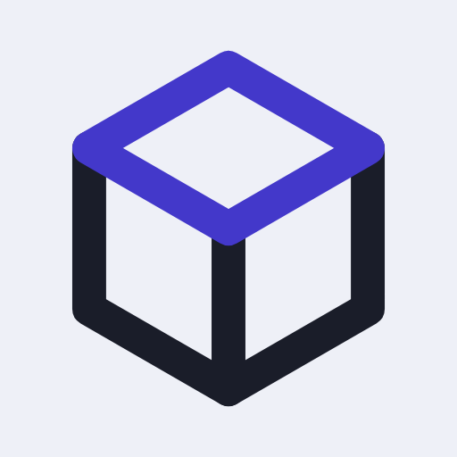

# opsbox

A container image that runs [Claude Code Remote
Control](https://code.claude.com/docs/en/remote-control) with a homelab
operations toolchain. Start a session from the Claude app on your phone, and
Claude works on a box that has your kubeconfig, talosconfig, SSH keys and
repositories, not on your laptop.

Unofficial; not affiliated with Anthropic.

## What's in it

| Tool | Where it comes from | How it stays current |
| --- | --- | --- |
| kubectl, talosctl, Terraform, TFLint, terraform-docs, uv, Node.js and npm, the Docker CLI with buildx and compose, cilium-cli, restic, ShellCheck, mise | Each project's own image, pinned by digest | Dependabot pull requests |
| Claude Code (stable channel), gh | The vendor's signed apt repository | The weekly release |
| Helm 4 | The official tarball from get.helm.sh, checked against its maintainers' signature | The weekly release |
| git, ssh, curl, jq, make, Python 3 with PyYAML, psql, sqlite3, tmux, dig, ping, nc, rsync and GNU coreutils | Debian 13 (trixie) | The weekly release, which also picks up Debian security fixes |

`docker run --rm ghcr.io/jarrodruggiero/opsbox opsbox-versions` lists the exact
versions in an image. Every release also attaches that list, for each
architecture, as `versions-amd64.txt` and `versions-arm64.txt`.

There is no Docker engine, no sudo, no setuid binary and no root at run time.
Everything runs as `opsbox` (uid 1000), which can write only to its home and
the temporary directories. Its home, and what its sessions and shells write,
are private to it.

## Running it

[`compose.yaml`](compose.yaml) is a complete example. After the first start,
open the manager page at `http://<the box's address>:8080/`:

1. **Sign in to Claude.** The page gives you a claude.ai link: sign in there,
   2FA included, and paste the code claude.ai shows into the page. Pasting it is
   the last step. Remote Control needs a claude.ai sign-in on a Pro, Max, Ultra,
   Team or Enterprise plan; a `claude setup-token` token or an API key can't
   start it.
2. **Answer its first-start questions.** Remote Control asks to trust
   `~/workspace` and to enable itself, once each. The page shows each one with
   Yes and No, or type the answer in the console.

The box then shows up under Remote Control in the Claude app and at
claude.ai/code, and new sessions start in `~/workspace`.

If the network drops for more than about 10 minutes, `claude remote-control`
exits, and the manager starts it again.

**The console** on the page is real. Its Remote Control tab is that process's own
terminal, and its Shell tab is `bash` on the box as `opsbox`, in `~/workspace`.
Each browser gets its own shell, which survives a reload, and closes after 12
hours with nobody viewing it and nothing running in it. What a shell prints stays
out of `docker logs`.

**Who can use the page.** It has no accounts of its own: a browser gets in by
signing in to Claude as the box's account. The box belongs to the account of
its first sign-in, so finish setup promptly; after that, any other account is
refused, even after you sign the box out. To move the box to another account,
sign it out, then delete `~/.config/opsbox/manager/owner` from a shell on the
box (`docker exec opsbox rm ~/.config/opsbox/manager/owner`).

**A signed-in browser is the box's own user:** it can open a shell and read every
key. The page is plain HTTP, so the sign-in code and the browser's session cross
the network unencrypted: fine on a trusted LAN; anywhere else, put HTTPS in front
of it and limit who can reach port 8080. It answers only to IP addresses and to
the names in `OPSBOX_MANAGER_HOSTS` (comma-separated), which stops DNS rebinding.

**Without the page:** set the container's command to `remote-control --spawn
same-dir`, as before the manager. Then sign in with `docker exec -it opsbox
claude auth login`, and answer its questions with `docker attach opsbox` (it
needs `tty` and `stdin_open`), detaching with Ctrl-P Ctrl-Q.

**Trusting `~/workspace` trusts everything under it.** Claude Code carries a
directory's trust down to every directory inside it, so a repository cloned
there can run its own hooks and settings (`.claude/settings.json`) with all
your keys, without asking. Keep `~/workspace` for repositories you control.
Clone anything else, such as someone else's project or a pull request from a
fork, outside it, in `~/untrusted` say, where Claude Code asks first.

### On Unraid

The template is `unraid/opsbox.xml`. Its home is a share of its own with SMB
and NFS export off, owned by 1000:1000 rather than Unraid's usual 99:100,
because NFS squash makes every client own 99:100 files and SMB shares often
force root, exposing keys to the LAN. Give it its own address on br0 so
firewall rules can name it. Never map the Docker socket.

### Your keys

Everything personal lives in the volume at `/home/opsbox`, and none of it is
in the image. The manager page puts things there three ways:

- **Upload files:** choose files or a whole folder and say where they go, under
  `~`. A kubeconfig goes to `~/.kube/config`, a talosconfig to `~/.talos/config`,
  gh's to `~/.config/gh/hosts.yml`, Terraform's to
  `~/.terraform.d/credentials.tfrc.json`. A folder keeps its name and the
  structure of its files, though not its empty folders, up to 1,000 files at a
  time. Files are private to the box's user (a script loses its execute bit), up
  to 1 MiB each, and the page shows only their path, size and date.
- **Environment:** any name and value, applied the next time Remote Control or a
  shell starts. Hide a value and it's never sent to a browser again (names that
  look secret, like `GH_TOKEN`, hide themselves, and a hidden one stays hidden
  until you remove it). The few that would turn Remote Control off or replace its
  sign-in are refused with the reason.
- **SSH key:** generated on the box, with only its public half shown.

Claude Code keeps its own sign-in and settings in `~/.claude` and
`~/.claude.json`. Clone repositories into `~/workspace` (see the trust note
above).

**Skills from a git repository:** set `OPSBOX_SKILLS_REPO` to its URL, such as
`git@github.com:you/claude-skills.git`, and each start of Remote Control brings
`~/.claude/skills` up to date from it, so Restart picks up a changed skill. It
uses the box's own credentials. For SSH that's the key from the manager page,
added to the repository as a deploy key; GitHub's host keys are already in the
image. The repository needs a `main` branch, and nothing in a `synced/` folder:
that's where claude.ai keeps its own skills, so a repository with files there is
refused rather than let git replace them. It only ever fast-forwards: changes on
the box, another branch, or commits the repository doesn't have are left alone,
and the console says so.

The volume must be owned by uid 1000: `mkdir -m 0700 home && sudo chown
1000:1000 home`. On every start the entrypoint takes away other users' access
to it too, whatever mode it was created with. Back it up, and protect it like
the keys it holds.

Give the box the narrowest credentials that do the job. Anything that can read
your kubeconfig can do what your kubeconfig can do, and Claude can read it.

### Pinned tool versions in a repository

When a repository pins its tools in `.mise.toml` (Terraform, say), run this
once in it:

    mise trust && mise install

From then on, that repository gets its pinned versions, and everywhere else
gets the baked ones. Until then its pins are ignored, so do this before running
Terraform in a repository whose CI uses an older version than the image: a
newer Terraform can write state that an older one isn't guaranteed to read.

Trust covers the file's exact contents (the image sets `MISE_PARANOID`). A
mise config can run commands, so when a pull changes it, mise refuses to run
until you've read the change and run `mise trust` again. An untrusted
`.tool-versions` is refused the same way.

### Network

Give the box its own address, and allow outbound traffic only where it needs to
go:

- **Claude Code:** the hosts in [its network
  requirements](https://code.claude.com/docs/en/network-config#network-access-requirements).
  At minimum that's `api.anthropic.com`, `claude.ai`, `claude.com` and
  `platform.claude.com` on 443.
- **Your tools:** GitHub (`github.com`, `api.github.com`, `ghcr.io`), any
  registries you pull from, and your own Kubernetes API, Talos API and SSH
  hosts.

Don't set `CLAUDE_CODE_DISABLE_NONESSENTIAL_TRAFFIC` or `DISABLE_GROWTHBOOK`:
either one turns Remote Control off.

### Docker

The image has the Docker CLI but no engine. To build images from the box, give
it an engine of its own, in a VM, and point the CLI at it with
`DOCKER_HOST=ssh://user@vm`. Never give it the host's socket: whatever can
reach a Docker socket is root on the machine the engine runs on.

## Versions

Releases are automatic. Every merge to `main` that changes the image produces
one (merges that land while one is building share the next), and so does the
weekly build when a floating tool or a Debian package has moved. The version
says how much changed:

- **Major:** a big refactor of the image, chosen by raising the number in
  [`MAJOR_VERSION`](MAJOR_VERSION).
- **Minor:** a tool had a major update, or a tool was added or removed. Either
  can break a script that uses it.
- **Patch:** anything else. Minor and patch updates to tools, Debian package
  updates, and changes to the image's own files.

A tool's major version is its first number, except for 0.x versions, where it
is the second, and calendar versions such as mise's `2026.10.25`, where it
never counts. [`scripts/next-version.py`](scripts/next-version.py) applies
these rules, and its tests pin them.

Each release `vX.Y.Z` is published as `X.Y.Z`, `X.Y`, `X` and `latest`:

- **`X`** gets every release until a big refactor raises the major version. That
  includes tool majors (minor releases), which can break a script.
- **`X.Y`** gets only patch releases.
- **`X.Y.Z`** never changes.

Nothing pulls by itself. To update: `docker compose pull && docker compose up
-d`. Only the newest release gets fixes, Claude Code's and Debian's included,
so a pin on `X.Y` or `X.Y.Z` stops getting them when the next release lands.

To check that an image was built by this repository's release workflow:

    gh attestation verify oci://ghcr.io/jarrodruggiero/opsbox:1 -R jarrodruggiero/opsbox \
      --signer-workflow jarrodruggiero/opsbox/.github/workflows/release.yml \
      --source-ref refs/heads/main

Without the last two flags, an attestation made by any workflow on any branch
of the repository would pass.

### When a release is bad

1. Pin the last good `X.Y.Z` in your compose file.
2. Maintainers: point `X`, `X.Y` and `latest` back at it with `docker buildx
   imagetools create`, and disable the Release workflow (`gh workflow disable
   Release`) until a fix is merged. Otherwise the next run, or the weekly one,
   rebuilds with the same newest packages and moves them forward again.
3. If a release stopped after tagging the image but before the GitHub release
   exists, nothing is stuck. That version keeps its image with no release, and
   the next run takes the next number.
4. Never delete a published image version or its git tag. A missing image
   stops every later release, because each one compares itself with the last.
   A deleted tag makes the next release compare itself with the tag before it,
   and an image deleted when it has no tag hands its number to the next release,
   under different contents.

## Changing it

- **To add a tool with an official image:** give it its own
  `FROM <image>:<tag>@sha256:<digest> AS <name>` stage, copy its binary out, and
  add it to `TOOLS` in
  [`opsbox-versions`](rootfs/usr/local/bin/opsbox-versions). Dependabot only
  reads FROM lines, so a tool pinned anywhere else never gets updated.
- **To test the scripts:** `python3 -m pytest tests`.
- **To test a built image:** `docker build -t opsbox:dev .`, then
  `OPSBOX_IMAGE=opsbox:dev python3 -m pytest tests/test_image.py`.
- **Keep `main` active.** GitHub turns off scheduled workflows in a public
  repository after 60 days without activity, and the weekly release is the only
  way gh, Claude Code, Helm and Debian fixes arrive. It emails first; turn the
  workflow back on from the Actions tab.

## Licence

[MIT](LICENSE).
